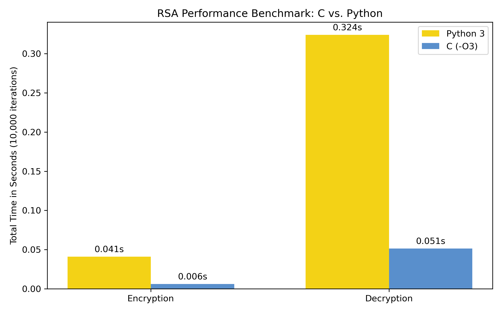

# 📊 RSA Performance Benchmark: C vs. Python

This benchmark evaluates the execution efficiency of the RSA encryption algorithm implemented in **C (C17 standard compiled with `-O3` optimization)** versus **Python 3**, running **10,000 iterations** of encryption and decryption over identical test inputs.

---
## 💡 Motivation & Inspiration

I did this project to refresh my C and Python skills with a practical project. Having learned the RSA algorithm during my Discrete Mathematics course, I became very enthusiastic by cryptography and wanted to implement the math from scratch in two different languages to analyse how compiled and interpreted implementations compare in terms of execution speed and memory management.

### Key Objectives
* **Code RSA from scratch:** Implement key generation, encryption, and decryption without external libraries.
* **Compare performance:** Measure and compare execution times between C and Python 3.
* **Ensure fair testing:** Keep benchmark logic separate from terminal prints (I/O) for accurate results.

  
## 🚀 Benchmark Results

| Language | Operation | Total Time (10,000 ops) | Avg Time / Op | Speedup |
| :--- | :--- | :--- | :--- | :--- |
| **C (`-O3`)** | Encryption | `0.006139 s` | `0.61 µs` | **~6.7x faster** |
| **Python 3** | Encryption | `0.040996 s` | `4.10 µs` | Baseline |
| **C (`-O3`)** | Decryption | `0.051282 s` | `5.13 µs` | **~6.3x faster** |
| **Python 3** | Decryption | `0.324084 s` | `32.41 µs` | Baseline |

---

## 📈 Visual Comparison

---

## 🔬 Technical Analysis (Still under work/research)

1. **Efficiency of Compiled C (`-O3`):**
   The C implementation achieves approximately **6x performance gains** across both operations. C is faster because it compiles straight to native machine code, running without the extra layers Python needs to execute code.

2. **Asymmetric Cryptography Complexity:**
   In both languages, decryption takes roughly **8x longer** than encryption:
   * **Encryption:** Uses a small public exponent ($e = 5$), requiring very few iterations in the modular exponentiation (Square and Multiply) algorithm.
   * **Decryption:** Uses a large private exponent ($d = 7,196,429$), demanding significantly more bit-shift and multiplication operations per character.

3. **Python Built-in Performance:**
   Despite being an interpreted language, Python delivers solid performance because the `pow(base, exp, mod)` built-in function is executed via C-native routines inside CPython.

---

## ⚙️ Environment & Setup

* **OS:** Ubuntu (WSL2) - 6.6.114.1-microsoft-standard-WSL2 GNU/Linux
* **C Compiler:** GCC (`-Wall -std=gnu17 -O3`)
* **Time Measurement (C):** `clock_gettime(CLOCK_MONOTONIC)`
* **Time Measurement (Python):** `time.perf_counter()`
* **Primes Used:** $p = 2377$, $q = 7573$ ($N = 18,001,021$)
